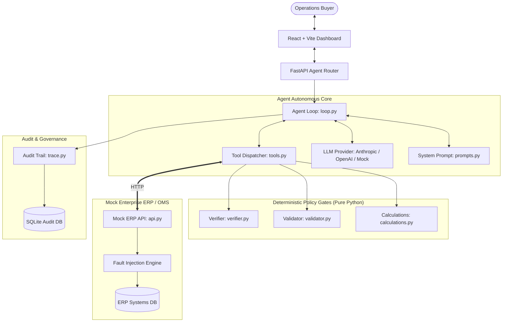
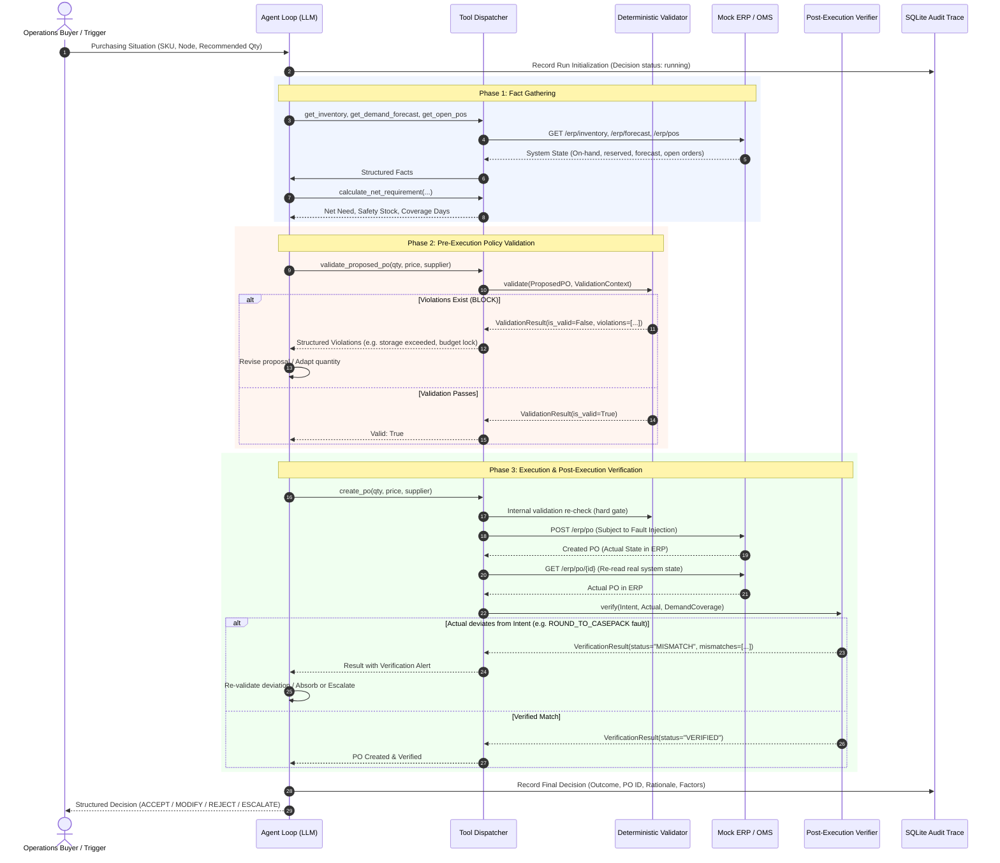

# Architecture & Technical Design: Autonomous AI Purchasing Agent

> **Core System Tenet:** *The LLM proposes, deterministic code validates.*  
> The Large Language Model never performs final constraint checks, never has arithmetic authority, and never directly writes to production databases. Every purchasing write is gated by a pure-code Validator and verified by a post-execution Verifier.

---

## 1. System Architecture Overview

The system is organized into distinct decoupled layers:
1. **Mock ERP / External Systems:** Separate REST router simulating inventory, demand forecasts, supplier catalogs, open purchase orders, storage capacity, and departmental budgets. Equipped with configurable fault injection.
2. **Deterministic Policy Layer:** Pure Python calculation functions (`calculations.py`), pre-execution constraint validator (`validator.py`), and post-execution state verifier (`verifier.py`).
3. **Agent Layer:** Autonomous tool-calling loop (`loop.py`), system prompt (`prompts.py`), tool dispatch registry (`tools.py`), and LLM provider abstraction (`llm.py`).
4. **Audit & Governance Layer:** SQLite step-by-step trace persistence (`trace.py`) recording all inputs, tool executions, outputs, violations, and verification results.
5. **Human-in-the-Loop Governance:** Human approval gating when PO values exceed configured thresholds (₹50,000), executing through the same deterministic gate upon manual sign-off.
6. **Frontend Dashboard:** React/Vite operational dashboard with scenario presets, real-time trace timeline, and fault injection switches.

---

## 2. Decision, Validate, Execute & Verify Sequence

The sequence diagram below illustrates how an order proposal moves from investigation to deterministic gating, execution, post-execution verification, and error recovery:

---

## 3. How Decisions are Validated

To ensure enterprise safety in automated supply chain operations, the system enforces **8 deterministic rules** before any PO can be committed:

| # | Policy Rule | Logic / Formula | Severity | Description |
|---|---|---|---|---|
| **1** | **Budget Check** | `PO value + committed <= budget total` | `BLOCK` | Prevents departmental spending over-runs for the category. Returns maximum affordable units. |
| **2** | **Storage Capacity** | `current_stock + incoming + proposed <= capacity` | `BLOCK` | Prevents warehouse overflow at the fulfillment node. Returns available shelf slots. |
| **3** | **MOQ & Case-Pack** | `qty >= moq AND qty % case_pack == 0` | `BLOCK` | Enforces supplier contractual minimums and packaging multiples. |
| **4** | **Supplier Availability** | `qty <= supplier.max_available_qty` | `BLOCK` | Ensures supplier can physically fulfill the quantity. |
| **5** | **Lead-Time Stockout Risk** | `available / daily_forecast < lead_time` | `WARN` | Alerts buyer when stockout is projected before shipment arrives. |
| **6** | **Over-Order Cap** | `coverage_days_after <= max_coverage (and <= shelf_life * 0.8)` | `BLOCK` | Prevents excessive inventory holding costs and spoilage for perishables (e.g. Milk with 5-day shelf life). |
| **7** | **Duplicate/Overlap** | `open_po_qty covers demand during lead time` | `WARN` | Flags redundant orders when existing open shipments already satisfy demand. |
| **8** | **Approval Threshold** | `PO value > ₹50,000` | `BLOCK` | Enforces corporate governance; requires human purchasing manager approval. |

---

## 4. Post-Execution Verification & Fault Recovery

External ERPs, OMS systems, and suppliers frequently introduce real-world anomalies:
- **`PARTIAL_ACCEPT`**: Supplier confirms lower quantity than requested.
- **`ROUND_TO_CASEPACK`**: ERP or EDI gateway silently rounds quantity up to master case size.
- **`ETA_SLIP`**: Delivery date pushed past contractual lead time.
- **`PRICE_CHANGE`**: Invoice price deviates from original quote.
- **`REJECT_BUDGET`**: Concurrent transaction consumed remaining budget during in-flight write.

### Verification Algorithm:
1. Immediately following `create_po` or `modify_po`, the tool layer issues an authoritative `GET /erp/po/{id}`.
2. Compares `POIntent` (what the agent proposed) against `POActual` (what was committed in the ERP database).
3. If delta exceeds tolerance thresholds (price tolerance 1.0%), flags `MISMATCH`.
4. Re-runs `coverage_days_after` calculation against the actual ERP state to verify demand remains covered.
5. Feeds the structured diff back into the agent conversation:
   - If acceptable: agent re-runs `validate_proposed_po` on actual state and safely absorbs the change (`outcome="MODIFY"`).
   - If unacceptable or unresolved: agent escalates or splits to an alternate supplier.

---

## 5. Design Decisions & Trade-offs

1. **Pure Tool-Calling Loop vs. Frameworks (LangChain/LlamaIndex):**
   - *Decision:* Built a plain Python tool-calling loop with typed schemas (`app.agent.loop`).
   - *Trade-off:* Avoided heavy, opaque abstractions; code is transparent, deterministic, and easily modifiable during an interview.
2. **Provider Abstraction with Mock Backend:**
   - *Decision:* Clean `BaseLLMProvider` interface with `MockLLMProvider`, `AnthropicLLMProvider`, and `OpenAILLMProvider`.
   - *Trade-off:* Enabled 100% deterministic, zero-cost, zero-API-key CI test suites and evals while preserving seamless production capability with Claude Sonnet.
3. **Database Isolation:**
   - *Decision:* The agent layer NEVER directly imports SQLAlchemy models for business data (`Inventory`, `Budget`, etc.).
   - *Trade-off:* Forces all queries through HTTP tools and mock ERP endpoints, mirroring production microservice boundaries.
4. **Programmatic Evaluation Rubric:**
   - *Decision:* Instead of fuzzy LLM-as-a-judge scoring, evaluated decisions programmatically against real ERP state in SQLite (6-dimensional rubric).
   - *Trade-off:* 100% reproducible, objective validation of supply chain correctness.

---

## 6. Limitations & Future Extensions

- **Multi-Node Rebalancing:** Future work could enable cross-docking or transshipment between Koramangala and Indiranagar dark stores before placing supplier purchase orders.
- **Dynamic Pricing Curves:** Incorporating supplier volume-discount tiered pricing in net requirement calculations.
- **Event-Driven Webhook Streaming:** Replacing synchronous HTTP polling with WebSocket or Server-Sent Events (SSE) for real-time frontend trace animation.
